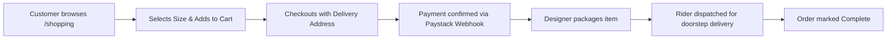
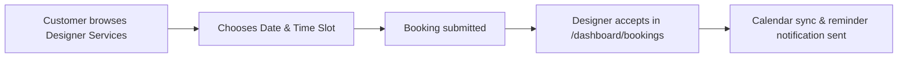

# TrendiZip (Trendiwear) — Master Project Documentation

> **Version:** 1.0.0  
> **Last Updated:** September 2026  
> **Target Audience:** Designers, Product Managers, Developers, and AI Coding Assistants  

---

## 1. Executive Summary: What is TrendiZip?

**TrendiZip** (also referred to internally as **Trendiwear**) is an all-in-one digital fashion marketplace and business operating system tailored specifically for the African fashion ecosystem, originating in **Ghana**. 

It bridges the gap between:
1. **Fashion Consumers & Shoppers** (locally and across the global African diaspora) seeking bespoke tailored outfits, authentic African luxury, and trendy ready-to-wear streetwear.
2. **Fashion Professionals** (bespoke tailors, high-fashion designers, seamstresses, and boutique brands) who need a digital storefront, an order management system, fitting appointments, and automated payout logistics.

TrendiZip is not just a standard e-commerce store like Amazon or ASOS. It is a **hybrid bespoke tailoring platform + ready-to-wear marketplace + service booking portal**, complete with an escrow payment system, body measurement profiles, rider delivery tracking, and AI-powered business tools for designers.

---

## 2. Why It Was Built: The Core Problems It Solves

### The Problem in Traditional African Fashion Commerce
* **Fragmentation & Lack of Visibility:** Incredible fashion designers and master tailors across Accra, Kumasi, Lagos, and beyond operate primarily through Instagram DMs, WhatsApp chats, or physical roadside shops. They lack professional online storefronts, inventory tracking, and payment processing.
* **The "What I Ordered vs. What I Got" Trust Gap:** Buying custom-made clothing online is notoriously risky. Customers fear paying upfront because tailors might deliver late, use the wrong fabric, or produce incorrect sizing. Tailors fear starting work without full payment because customers might reject or fail to pay for finished garments.
* **The Measurement Nightmare:** Bespoke tailoring requires up to 20 precise body measurements. Customers repeatedly lose their measurement notes or struggle to communicate them to new tailors, causing fitting errors and costly alterations.
* **Disjointed Logistics:** Once a garment is ready, designers rely on informal dispatch riders without unified tracking, leading to delivery delays and disputes over shipping fees.
* **Diaspora Accessibility:** Ghanaians and Africans living in the US, UK, Canada, and Europe struggle to discover, order from, and pay authentic local designers back home due to payment gateway restrictions and lack of reliable escrow.

### The TrendiZip Solution
* **Escrow Protection:** Customer funds are held securely until the customer verifies the product or service delivery.
* **Universal Measurement Vault:** Customers save their exact measurements once in their profile, which can be attached to custom orders with a single click.
* **Dual Commerce Modes:** Supports both off-the-shelf ready-to-wear pieces and fully customized bespoke tailoring orders.
* **Integrated Booking System:** Customers can book in-person consultations, measurement sessions, and fitting appointments.
* **Dedicated Logistics Network:** Integrated dispatch rider management for fast, reliable door-to-door delivery.
* **Designer Empowerment Tools:** Gives independent creators enterprise-grade tools: an AI Studio (for copywriting, launch planning, and pricing), financial analytics, and custom branded storefronts (`trendizip.com/tz/[brand-slug]`).

---

## 3. User Roles & Ecosystem

The platform recognizes four distinct user roles:

1. **Customers (Shoppers):**
   - Browse ready-to-wear catalogues and curated collections.
   - Discover local tailors and designers by location, specialty, and customer ratings.
   - Maintain a personal Body Measurement profile.
   - Purchase products via Paystack (Mobile Money / Cards).
   - Book tailor appointments (in-person or virtual).
   - Track custom tailoring progress and delivery status.
   - Leave reviews and participate in community style challenges.

2. **Professionals (Tailors, Seamstresses & Fashion Designers):**
   - Get a dedicated public storefront (`/tz/[slug]`) and portfolio showcase.
   - Manage an online product catalogue (ready-to-wear and made-to-order).
   - Receive and manage bespoke tailoring orders through workflow stages (Pending, Confirmed, Cutting, Sewing, Quality Check, Ready, Shipped).
   - Accept booking requests for consultations and fittings.
   - Create and issue custom shipping invoices.
   - Assign deliveries to registered riders.
   - Request wallet payouts directly to Mobile Money (MTN MoMo, Telecel Cash) or Bank accounts.
   - Use AI Studio tools to craft product descriptions, plan season launches, and price garments profitably.

3. **Riders / Couriers:**
   - Linked to professionals or the platform dispatch network.
   - Assigned delivery tasks with customer address, phone number, and pickup verification.
   - Update delivery status from pickup to doorstep delivery.

4. **Administrators (Admin & Super Admin):**
   - Platform-wide oversight: verify professional credentials (National ID, business registrations).
   - Review reported content, dispute management, and escrow resolution.
   - Manage platform commissions, site banners, fashion trends, and featured designers.

---

## 4. Comprehensive Page & Feature Tour

### Public / Client-Facing Pages (`app/(pages)`)

| Route | Page Title / Section | Description & Features |
|---|---|---|
| `/` | **Home / Landing Page** | High-impact hero introducing TrendiZip, curated new arrivals, trending designers, style spotlights, interactive category pills, and community proof. |
| `/shopping` | **Shopping Marketplace** | Full e-commerce browse experience. Features search, price filtering, category filtering (Men, Women, Unisex, Accessories, Streetwear), sorting, and quick-add to cart. |
| `/shopping/products/[id]` | **Product Details** | High-res image gallery, price in GHS, stock status, size selector, color options, tailor/designer profile link, customer reviews, and "Add to Cart" / "Buy Now". |
| `/shopping/categories` | **Categories Directory** | Visual cards for fashion categories (Kente, Streetwear, Corporate, Bridal, Casual, Bespoke Suits). |
| `/shopping/collections` | **Curated Collections** | Themed fashion drops, seasonal lookbooks, and collaborative designer capsules. |
| `/tailors-designers` | **Tailors & Designers Directory** | Interactive discovery page. Filter by craft (Master Tailor, Haute Couture, Streetwear Designer, Bridal Specialist), rating, location (Accra, Kumasi, etc.), and view their live portfolios. |
| `/tz/[slug]` | **Designer Storefront** | Dedicated public brand page for each professional. Displays brand banner, bio, verification badge, portfolio showcase, services offered, booking calendar, and their active product catalogue. |
| `/fashion-trends` | **Fashion Trends & Style Feed** | Editorial trends, style guides, outfit inspirations, and community challenges where users vote on the best outfits. |
| `/blog` | **TrendiZip Editorial & Magazine** | Fashion culture, runway recaps, designer spotlight interviews, and styling tips. |
| `/measurements` | **My Measurement Vault** | Visual interactive guide for customers to record and update their exact body dimensions (bust, waist, hips, shoulder, arm length, inseam, height, unit selector in inches or cm). |
| `/cart` | **Shopping Cart** | Itemized summary of ready-to-wear items and bespoke order requests, quantity adjustments, and subtotal calculation. |
| `/checkout` | **Checkout & Escrow Payment** | Delivery address selection, Paystack payment integration (supporting Ghana Mobile Money and Visa/Mastercard), order review, and escrow security badge. |
| `/orders` | **Customer Orders** | Track active orders with a visual milestone stepper (Confirmed → In Production → Ready for Delivery → Delivered), order receipts, and return/dispute triggers. |
| `/bookings` | **Customer Bookings** | View and manage scheduled fitting or consultation appointments with designers. |
| `/wishlist` | **Saved Items** | Customer's collection of bookmarked products and design inspirations. |
| `/messages` | **Live Chat & Consultation** | Direct messaging between shoppers and fashion designers for consultation, fabric selection, and custom order updates. |
| `/register-as-professional` | **Join as Designer / Tailor** | Multi-step onboarding for fashion professionals: business details, specialty selection, verification document upload (National ID / Business Cert), and portfolio setup. |
| `/auth/signin` | **Sign In & Sign Up** | Editorial split-screen auth with Google One-Tap/OAuth, account creation, terms agreement, and direct redirect back to the user's intended page. |
| `/survey` | **Style & Fit Survey** | Onboarding quiz to capture buyer style preferences, favorite colors, and clothing aesthetic for personalized recommendations. |
| `/size-guide` | **Universal Size Guide** | Educational reference chart for African, UK, US, and EU clothing conversions. |
| `/help`, `/faq`, `/terms`, `/privacy`, `/shipping` | **Information & Legal** | Customer care center, escrow explanations, delivery policies, and terms of service. |

---

### Dashboard Pages (`app/dashboard/(shell)`)

Accessible by logged-in fashion professionals and administrators:

| Dashboard Route | Section Name | Key Features & Business Purpose |
|---|---|---|
| `/dashboard` | **Overview / Executive Cockpit** | At-a-glance performance: total revenue, pending orders, active bookings, wallet balance, recent activity feed, and rating summary. |
| `/dashboard/catalogue` | **Product & Inventory Management** | Add/edit/delete products, manage sizes, colors, fabric types, stock levels, upload multi-angle photos, set ready-to-wear vs made-to-order tags. |
| `/dashboard/orders` | **Bespoke & Retail Order Pipeline** | Kanban / list view of orders. Designers can advance order status: *Confirmed → Fabric Sourced → Cutting → Sewing → Final Fitting → Dispatched*. Attach customer measurements directly to the order sheet. |
| `/dashboard/bookings` | **Appointment Scheduling** | Calendar and list view of upcoming customer bookings for in-person fittings or consultations. Accept, reschedule, or cancel appointments. |
| `/dashboard/services` | **Custom Tailoring Services** | Define custom service offerings (e.g., "3-Piece Agbada Bespoke Tailoring", "Alterations & Resizing", "Bridal Gown Styling") with turnaround times and base pricing. |
| `/dashboard/customers` | **Client Relationship Management (CRM)** | Directory of past and recurring clients, their purchase history, saved measurements, and contact notes. |
| `/dashboard/analytics` | **Revenue & Growth Analytics** | Financial charts (using Recharts), sales volume, average order value, top-selling designs, and customer retention metrics. |
| `/dashboard/riders` | **Dispatch & Delivery Fleet** | Add and manage delivery riders, assign orders for pickup, track transit status, and view delivery confirmations. |
| `/dashboard/showcase` | **Portfolio & Lookbook Manager** | Upload high-resolution runway shots, model showcases, and video spotlights that appear on the designer’s public `/tz/[slug]` page. |
| `/dashboard/trends` | **Trend Insights & Competitions** | View trending styles on the platform, participate in platform-wide fashion challenges, and submit designs for feature spotlights. |
| `/dashboard/ai-studio` | **AI Creative Studio** | The designer’s AI co-pilot suite: generates creative garment descriptions, marketing angles, and social media captions. |
| `/dashboard/ai/pricing-strategist` | **AI Pricing Strategist** | Analyzes fabric cost, labor hours, complexity, and market benchmarks to recommend profitable retail and bespoke pricing. |
| `/dashboard/ai/launch-planner` | **AI Launch Planner** | Step-by-step roadmap generator for launching new seasonal collections (Christmas, Easter, Wedding Season, Year of Return / Detty December). |
| `/dashboard/ai/market-research` | **AI Market Research** | Trends analysis on popular African fabrics, silhouettes, and consumer color preferences. |
| `/dashboard/settings` | **Business & Payout Settings** | Profile setup, business name, GPS/location coordinates, operating hours, payout account setup (MoMo / Bank), and subscription plan tier. |

---

## 5. Core Business & Technical Workflows

### Workflow A: Bespoke Tailoring Order

```mermaid
flowchart LR
    A[Customer finds Tailor on /tailors-designers] --> B[Views Tailor Profile /tz/slug]
    B --> C[Selects Bespoke Style & Attaches Saved Measurements]
    C --> D[Pays via Paystack Escrow]
    D --> E[Tailor receives Order in Dashboard]
    E --> F[Tailor advances status: Cutting -> Sewing]
    F --> G[Tailor marks Ready & Assigns Rider]
    G --> H[Customer receives delivery & verifies fit]
    H --> I[Escrow released to Tailor's Wallet]
```

### Workflow B: Ready-to-Wear E-Commerce Purchase

### Workflow C: Fitting / Consultation Booking

---

## 6. Current Gaps, Incomplete Areas & Recommended Roadmap

This section identifies areas that are either partially built or prime candidates for enhancement:

### 1. Measurements Experience
* **Current State:** The user can save static measurements in `/measurements`.
* **Gap / Opportunity:**
  - Introduce an interactive 3D or visual avatar body-map showing *where* on the body each measurement should be taken to eliminate customer measurement errors.
  - Allow tailors to submit updated measurements on behalf of the customer after an in-person fitting session.

### 2. Live Order Tracking & Rider Experience
* **Current State:** Delivery stages are updated manually by the professional.
* **Gap / Opportunity:**
  - Integrate a live GPS map view (via the existing Leaflet / Google Maps setup) so customers can see their rider in transit on delivery day.
  - Add SMS / WhatsApp automated notifications (e.g., via Twilio or Arkesel) for order milestones, which is the primary communication channel in West Africa.

### 3. Messaging & Consultations (`/messages`)
* **Current State:** Basic conversation data structure exists in Prisma.
* **Gap / Opportunity:**
  - Enhance real-time chat with photo sharing (fabric swatches, reference photos, video snippets of garment fittings).
  - Add quick action: "Send Custom Quote" directly within chat, enabling the designer to quote a custom price that the buyer can pay directly from the chat thread.

### 4. Payouts & Wallet Automation
* **Current State:** `PayoutRequest` and `WalletTransaction` models exist; balance tracked in database.
* **Gap / Opportunity:**
  - Connect automatic Paystack Transfers API so approved payouts to MTN MoMo and Telecel Cash are executed automatically without manual bank intervention.

### 5. AI Studio Deep Integration
* **Current State:** AI tools exist in dashboard routes (`/dashboard/ai/...` and `/dashboard/ai-studio`).
* **Gap / Opportunity:**
  - Connect OpenAI / Gemini API keys to the backend routes to generate one-click product descriptions directly inside the product upload modal in `/dashboard/catalogue`.
  - Add Virtual Try-On or AI Outfit Visualization where customers can visualize fabrics on digital models.

### 6. Mobile Optimization & PWA
* **Current State:** Responsive web app built with Tailwind CSS.
* **Gap / Opportunity:**
  - Add Progressive Web App (PWA) manifest and service worker so tailors can install TrendiZip on their Android/iOS home screens like a native app.

---

## 7. Technology Stack Reference

* **Framework:** Next.js 15 (App Router with Server & Client Components)
* **Language:** TypeScript 5
* **Styling:** Tailwind CSS 3 with Framer Motion animations & Radix UI primitives
* **Database:** PostgreSQL (hosted via Supabase)
* **ORM:** Prisma 7 with `@prisma/adapter-pg`
* **Authentication:** NextAuth.js 4 (Google OAuth & Credentials provider)
* **Payments:** Paystack (`react-paystack` integration for Ghana Cedi, Mobile Money & Cards)
* **Maps & Geo:** Leaflet, React-Leaflet, Google Maps JS API Loader
* **Data Visualization:** Recharts
* **State Management:** Zustand & SWR
